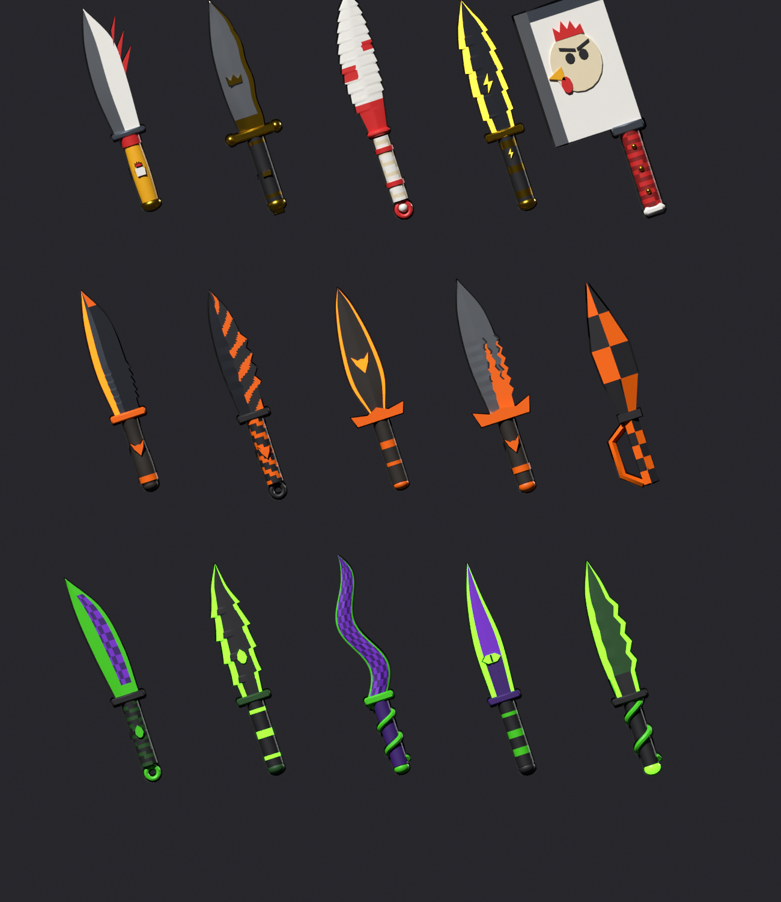
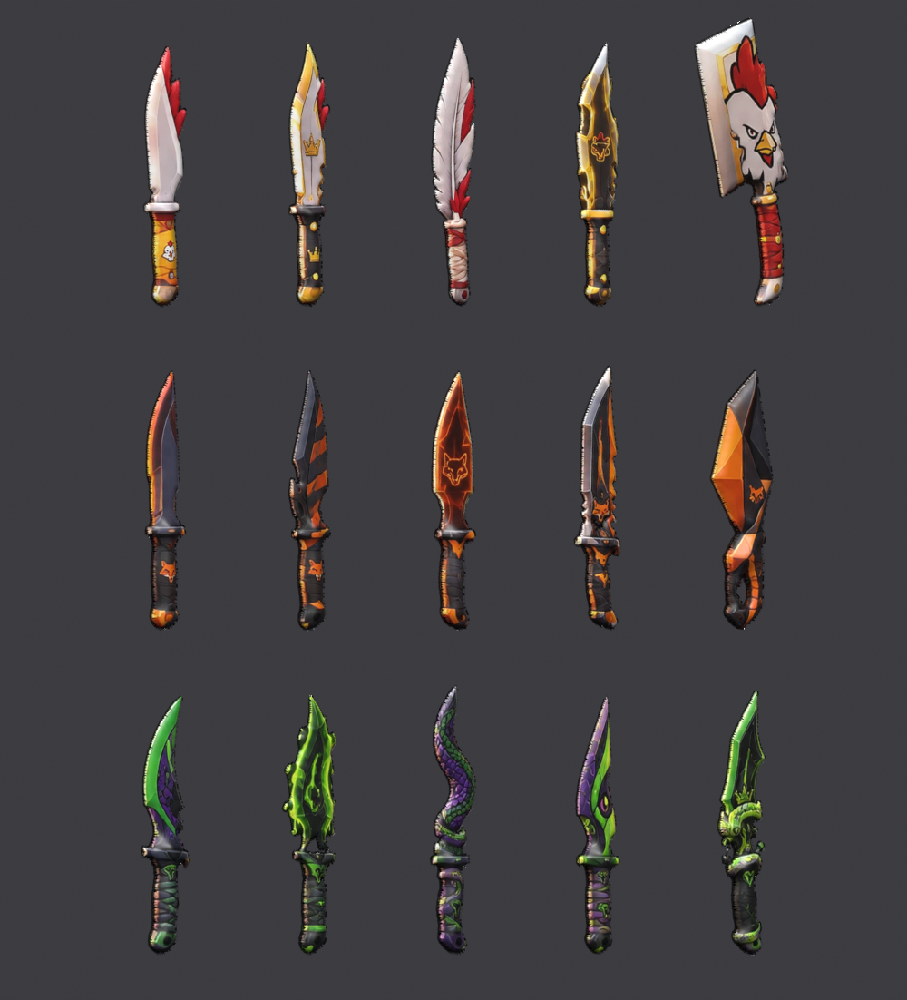

# 🔪 Couteaux — Poule Renard Vipère

15 couteaux en 3D (5 par équipe) **tirés directement de l'image de référence** (`apercu/reference.webp`) : silhouette exacte, texture = l'image elle-même, relief 3D (lame fine biseautée, manche arrondi), contour noir cartoon. Avec effets VFX, sons SFX, combo d'attaque, esquive et vérification côté serveur.




## Contenu du dossier
| Fichier | Rôle |
|---|---|
| `modeles/*.glb` | Les 15 couteaux **déjà prêts** à importer dans Studio (texture incluse dans le fichier). |
| `modeles/textures/` | Les textures en PNG (et le masque de détourage de chaque couteau). |
| `modeles/infos.json` | Longueur et hauteur de garde de chaque couteau (studs). |
| `outils/couteaux_depuis_image.py` | Le générateur : image → détourage → modèle 3D texturé → .glb (Blender en Python). |
| `outils/masques/` | Détourages IA (BiRefNet) de chaque couteau. |
| `outils/apercu_glb.py` | Rend une planche d'aperçu des .glb. |
| `roblox/Config.lua` | ModuleScript `ReplicatedStorage.Couteaux.Config` : couleurs, combat, effets, sons, animations. |
| `roblox/FX.lua` | ModuleScript `ReplicatedStorage.Couteaux.FX` : tous les effets visuels et sonores. |
| `roblox/CouteauxServeur.lua` | Script `ServerScriptService.CouteauxServeur`. |
| `roblox/CouteauxClient.lua` | LocalScript `StarterPlayer.StarterPlayerScripts.CouteauxClient`. |
| `roblox/InstallerCouteaux.lua` | À coller **une fois** dans la Barre de commandes. |
| `PROMPT_CLAUDE_CODE.md` | Le texte à donner à ton Claude Code (Studio + Blender). |

## Installation dans Studio (5 minutes)
1. Dans **ReplicatedStorage**, créer un dossier `Couteaux`. Dedans, deux **ModuleScripts** : `Config` (coller `roblox/Config.lua`) et `FX` (coller `roblox/FX.lua`).
2. **Importer 3D** (Accueil > Importer 3D) les 15 fichiers `.glb` de `modeles/`, options par défaut (la texture est incluse).
3. **Barre de commandes** : coller `roblox/InstallerCouteaux.lua` puis Entrée. Les couteaux deviennent des Tools dans `ReplicatedStorage.Couteaux.Outils`. Rien n'est supprimé : les modèles importés vides restent dans le Workspace, tu peux les effacer toi-même.
4. **ServerScriptService** : Script `CouteauxServeur`. **StarterPlayer > StarterPlayerScripts** : LocalScript `CouteauxClient`.
5. **Play** (au moins 2 joueurs : Test > Serveur local, 2 joueurs) pour vérifier.

## Les commandes
- **Clic / tap / R2** : attaque en combo 1-2-3. Le 3e coup est un estoc avec plus de portée.
- **Q / bouton B / bouton ESQUIVE (mobile)** : dash avec 0,35 s d'invincibilité et images fantômes.
- Seule l'équipe que tu chasses peut être touchée : Poule → Vipère → Renard → Poule.

## Brancher sur le jeu existant
- **Équipe d'un joueur** : nom de sa Team (contient « poule », « renard » ou « vip »), ou attribut `Equipe` sur le Player.
- **Quand quelqu'un est touché** : `ServerStorage.CouteauxEvents.Touche` est déclenché avec `(attaquant, victime, idCouteau)`. Il suffit d'y brancher l'envoi en prison :
  ```lua
  game.ServerStorage:WaitForChild("CouteauxEvents").Touche.Event:Connect(function(attaquant, victime, id)
      -- envoyer « victime » en prison ici
  end)
  ```
- **Attributs respectés** : `EnPrison = true` sur le Player (ne peut ni attaquer ni être touché), `Invincible = true` sur le Character.
- **Choisir un couteau** : `player:SetAttribute("Couteau", "PouleRoyal")`, puis le prochain respawn le donne. Le couteau doit être de la bonne équipe.
- **Si le jeu donne déjà les armes** : `Config.Combat.DonnerCouteau = false`.

## Refaire les modèles avec de meilleures images
Plus l'image est grande, plus la texture est nette. Ta planche donne environ 130 × 330 pixels par couteau.
Avec une image par couteau (environ 1000 px de haut, fond noir uni), on refait tout en une commande :
`python outils/couteaux_depuis_image.py <image> outils/masques <sortie>`.
Il faut régler `BOITES` (position du couteau dans l'image) et refaire le masque avec rembg (`birefnet-general`).

## Effets de chaque couteau
| Couteau | Aura | Impact |
|---|---|---|
| Poule base / plume | plumes qui tombent (plume) | explosion de plumes blanches et rouges |
| Poule royal | étincelles dorées + lueur | étoiles dorées + onde |
| Poule électrique | étincelles + lumière qui grésille | **éclairs** en zigzag + son électrique |
| Poule géant | — | grosse onde de choc + poussière + forte secousse |
| Renard base | — | éclats orange |
| Renard furtif | fumée sombre | nuage noir + étincelles |
| Renard spectre | flammes fantômes | feu spectral qui monte |
| Renard légendaire | flammes + lueur | explosion de flammes + braises |
| Renard origami | — | **éclats de papier** triangulaires |
| Vipères | bulles / gouttes / fumée violette / étincelles vertes | nuage de poison + gouttes + onde |

Toutes les couleurs, auras, sons et forces de secousse se règlent dans `Config.Couteaux`.

## 🎬 Animations (R15)
| Animation | Durée | Priorité | Description |
|---|---|---|---|
| `Coup1` | 0,52 s | Action2 (haut du corps) | Taille horizontale : armé à droite, coup rapide, follow-through à gauche |
| `Coup2` | 0,55 s | Action2 (haut du corps) | Revers en diagonale depuis l'épaule gauche |
| `Coup3` | 0,62 s | Action2 (corps entier) | Estoc : on se ramasse puis fente en avant, bras tendu |
| `Esquive` | 0,48 s | Action3 (corps entier) | Roulade avant |
| `Course` | 0,6 s (boucle) | Movement | Sprint penché, remplace la course de Roblox |
| `Garde` | 1,6 s (boucle) | Action (haut du corps) | Garde couteau en main, respiration |

Aperçus : `animations/apercu/*.gif`. Les coups ne touchent pas les jambes : on peut attaquer en courant.

**Comment c'est fait** : `animations/animations_r15.py` construit dans Blender un squelette R15 identique à Roblox (un os par pièce, mêmes pivots, mêmes axes). Les jambes sont posées en IK, et les animations ont de vraies courbes (anticipation, impact rapide, follow-through, retour). Le script exporte ensuite `roblox/InstallerAnimations.lua` : un script qui recrée les animations en KeyframeSequence directement dans Studio, sans l'import FBX qui casse souvent. `animations/R15_animations.blend` contient le squelette et les 6 Actions, pour les retoucher dans Blender (Dope Sheet / Graph Editor).

**Installer** :
1. *(pour publier)* Avatar > **Constructeur de rig** > R15 > Bloc : un modèle « Rig » apparaît dans le Workspace.
2. Barre de commandes : coller `roblox/InstallerAnimations.lua`, puis Entrée. Les animations sont créées dans `ReplicatedStorage.Couteaux.Animations` (et dans `Rig.AnimSaves`).
3. **Tester tout de suite** : en Play dans Studio, elles marchent déjà, même sans ID.
4. **Publier** (obligatoire pour le jeu en ligne) : Éditeur d'animation > cliquer le Rig > « … » > Charger > choisir l'animation > « … » > Publier sur Roblox. Copier l'ID dans `Config.Animations` (`"rbxassetid://123…"`). À faire pour les 6.

**Modifier une animation** : soit dans Blender (retoucher l'Action, puis dans la console Python `exporter_lua(bpy.data.objects["R15"], "chemin/InstallerAnimations.lua")`), soit en changeant les poses dans `ANIMS` du script et le relancer.

## À faire ensuite
- **Sons** : remplacer les sons intégrés par de meilleurs sons de la Boîte à outils (`Config.Sons`).
- **Publier** (Alt+P) après les tests.
