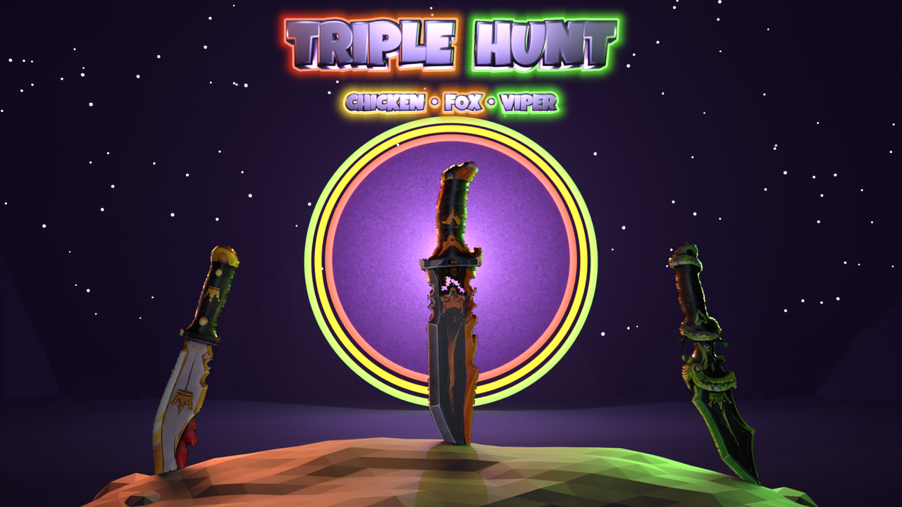

# 🎬 TRIPLE HUNT — Interface

Deux parties : l'**écran de chargement** (ci-dessous) et l'**interface de jeu** (en bas). Textes à donner à Claude dans Studio : `PROMPT_CLAUDE_STUDIO.md`.

## Écran de chargement



Vidéo de l'animation : `apercu/apercu_chargement.mp4`.

## Ce qu'il fait
| Temps | Animation | Son |
|---|---|---|
| 0 s | Le ciel étoilé et le portail apparaissent (zoom lent, anneau qui tourne, rayons de lumière) | — |
| 0,5 s | Le rocher monte depuis le bas | — |
| 1,4 / 1,85 / 2,2 s | Les 3 couteaux géants tombent et **se plantent** : éclats de roche, fissure lumineuse, lueur de la couleur de l'équipe, ombre du couteau qui se forme, poussière, flash, secousse | sifflement + impact + grondement |
| 2,6 s | Le titre **TRIPLE HUNT** arrive en rebondissant, puis un reflet passe dessus toutes les 4 s | tintement |
| 3 s | Barre de chargement (dégradé aux couleurs des équipes, rayures qui défilent) + astuces écrites lettre par lettre (badge ASTUCE, noms d'équipes en couleur, sans emoji) | — |
| Prêt | « PRÊT ! » puis le bouton **JOUER** pulse (clic, Entrée ou bouton A de la manette) | tintement |
| Clic | Coup de lame qui tranche l'écran, flash, zoom et fondu vers le jeu | lame |

Toujours présents : braises colorées qui montent, étoiles qui scintillent, parallaxe à la souris. La barre suit le **vrai** chargement (préchargement des images, sons, maillages, animations), avec une durée minimale de 7 s pour l'intro. Le bouton PASSER apparaît après 2,5 s.

## Fichiers
| Dossier | Contenu |
|---|---|
| `images/` | Les 30 images à importer dans Roblox (toutes ≤ 1024 px). |
| `roblox/EcranChargement.lua` | LocalScript `ReplicatedFirst.EcranChargement`. |
| `roblox/InstallerImages.lua` | À coller une fois dans la barre de commandes, après l'import des images. |
| `blender/rendus_interface.py` | Toute la scène 3D (ciel, portail, rocher, couteaux, ombres, titre, éclats de roche). |
| `blender/finition_logo_scene.py` | Liseré néon et lueur du titre (champ de distance, contours lisses). |
| `blender/ombres_couteaux.py` | Ombres des couteaux sur le rocher (couches séparées). |
| `blender/textures_effets.py` | Textures des effets (anneau, rayons, braise, étincelle, lame, fissure, fumée). |
| `blender/exporter_images.py` | Découpe/rognage pour Roblox et écriture des positions dans le script. |

## Changer le nom ou les couteaux
Dans `blender/rendus_interface.py` : `NOM_DU_JEU`, `SOUS_TITRE`, les couteaux dans `avant_plan()`. Ensuite, relancer :
```
blender -b -P rendus_interface.py -- <dossier_glb_couteaux> <rendus> ciel avant logo_scene eclats
python ombres_couteaux.py <rendus>
python finition_logo_scene.py <rendus>/chargement_logo.png <rendus>/chargement_logo_final.png
python textures_effets.py <rendus>/chargement_logo_final.png <fx>
python exporter_images.py <rendus> <fx> images roblox/EcranChargement.lua
```

---

## Interface de jeu

Aperçus : `apercu/jeu_a_lobby.png` … `jeu_f_parametres.png` (l'onglet Caisses affichera **tes** caisses).

Style : verre violet sombre, coins biseautés, liserés néon fins, polices Montserrat / Oswald, tes icônes 3D intactes, reflets qui balaient les boutons, sons d'interface.

| Écran | Contenu | Animations |
|---|---|---|
| Lobby | profil + niveau/XP, prochaine manche, pièces (+), paramètres, 6 raccourcis (Boutique, Quêtes, Caisses, Cadeau, Couteaux, Top), équipe | entrée en glissant, icônes qui bondissent au survol, halo doré qui respire sur Caisses, pastilles qui rebondissent, compteur de pièces qui défile |
| Manche | tu es / chasse / fuis, chrono, libres par équipe, fil des captures, combo | chrono rouge qui pulse les 10 dernières s, barre qui tressaille à chaque capture, notification avec onde |
| Danger | flèche « RENARD PROCHE ! » + bord rouge quand ton chasseur arrive hors de l'écran | pulsation |
| Mobile | FRAPPER, ESQUIVE (recharge chiffrée), SPRINT (si le jeu en a un) | anneaux segmentés qui tournent, onde quand l'esquive est prête |
| Boutique | CAISSES (tes caisses : liste, vitrine, contenu, chances, x1 / x5), COUTEAUX (inventaire, équiper), PIÈCES (Robux) | fenêtre qui sort du bouton cliqué, rayons qui tournent, caisse qui flotte |
| Ouverture | la caisse tremble, éclair, roue qui ralentit, révélation (rayons de la rareté, ondes, étincelles, NOUVEAU !), ÉQUIPER / CONTINUER, PASSER ; x5 = 5 cartes qui se retournent | |
| Paramètres | Son (musique, effets), Graphismes (secousses, mode performance, ombres), Contrôles (touche d'esquive), Jeu (fil, alerte, ouverture rapide) | curseurs, interrupteurs |
| Quêtes / Cadeau / Classement | progression + RÉCLAMER, cadeau avec compte à rebours, top avec médailles | |

| Fichier | Rôle |
|---|---|
| `roblox/InterfaceJeu.lua` | LocalScript de démarrage (mise à l'échelle 1280×720 → tous les écrans, fenêtres, Échap / B pour fermer) |
| `roblox/Interface/Style.lua` | couleurs, polices, textures 9-slice, boutons animés, sons |
| `roblox/Interface/Donnees.lua` | le pont avec le jeu (`D.Etat`, `D.Actions`, `D.Caisses`) — valeurs de démo tant que rien n'est branché |
| `roblox/Interface/HUD.lua` · `Panneaux.lua` · `Ouverture.lua` | HUD / fenêtres / ouverture des caisses |
| `roblox/BranchementInterface.lua` | modèle que Claude adapte à ton jeu (pièces, caisses existantes, manche, achats) |
| `blender/generer_skins.py` | textures des panneaux et boutons |
| `blender/finition_icones.py` | contour + halo des icônes 3D |

Réglages lus par le reste du jeu (attributs du joueur) : `Param_Musique`, `Param_Effets`, `Param_Secousses`, `Param_Performance`, `Param_Ombres`, `Param_ToucheEsquive`, `Param_Fil`, `Param_Danger`, `Param_OuvertureRapide`. Sons : groupes `SoundService.Musique` et `SoundService.Effets`.
